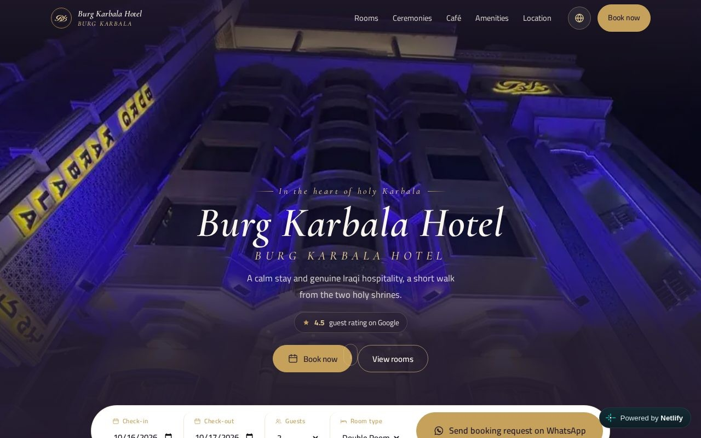

# Burg Karbala Hotel

Website for **Burg Karbala Hotel** in Karbala, Iraq: a one-page hotel site in Arabic and English with a right-to-left layout.

**Live site:** https://warm-semolina-db2e54.netlify.app

## What's on the page

- Rooms with photos, guest count and a "Book this room" button
- Events, the rooftop café (linked to the hotel's [digital café menu](https://github.com/ahmad4241/coffee-menu)), amenities and guest reviews
- Location with Google Maps, phone, Instagram and Facebook
- Booking requests sent straight to the hotel's WhatsApp
- Arabic and English, switching between right-to-left and left-to-right
- Responsive on phone, tablet and laptop, with link previews for WhatsApp and social media

## Built with

HTML, CSS and plain JavaScript in a single `index.html`, no frameworks. Images in WebP. Hosted on Netlify.

Designed and built by [Ahmad Alhallak](https://ahmadalhallak.com) for a client, with AI assistance (Claude).

## Run it

Open `index.html` in a browser. Keep the images in the same folder.
